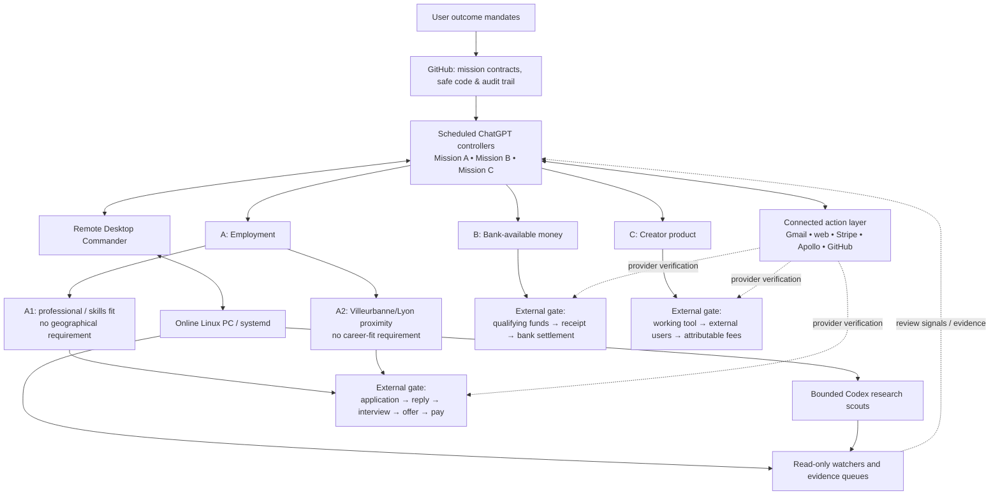

# Mission Control — architecture and outcome board

> Snapshot audited on **12 November 2026, ~16:55 Europe/Paris**. This document is **not live telemetry**. It is a public, sanitized map: personal correspondence, credentials, private queue identifiers, banking records and recipient-specific evidence are deliberately excluded.

## 1. What is connected?

**Permission boundary.** Local Linux processes do not inherit ChatGPT's Gmail, Stripe, Apollo, or banking permissions. A scheduled ChatGPT run is not a resident 24/7 model. Codex scouting is research, not independent commercial execution.

## 2. Current verified outcome stages

| Mission | Verified work / infrastructure | Outcome that remains unverified | Most consequential next gate |
| --- | --- | --- | --- |
| **A — Employment, A1 & A2 independently** | Both source feeds operating. Two new distinct job-related emails sent 12 Nov through connected tools. | Interviews, offer, salary. Source-listed jobs have not all been vetted; two employer questionnaires remain incomplete. | Complete truthful employer questionnaires and get an actual portal submission/acknowledgment in either lane. |
| **B — Net money in bank** | Local research/queue running; an outstanding invoice was sent with PDF attachment on 12 Nov. | Invoice settlement, incremental bank cash, a new accepted paying assignment. | Confirm earned receivable and payment; independently submit to a source-verified funded opportunity. |
| **C — Agentic creator product** | Read-only collector and dashboard running; Solana fee-inspection and token-authority checks tested. Latest controller reported 88 passing tests, 2 skipped. | Outside users, entitled creator fees, transferable or bank-settled earnings. | External demonstration/usage through an authorized channel, with independent proof. |

No artificial percentage completion is assigned. A successful technical test is not a commercial outcome.

## 3. Shared machinery and the real bottleneck

| Layer | Last verified position |
| --- | --- |
| ChatGPT automations | 5 active: three main outcome missions, one recruitment-response monitor and one weekly AI brief. Another 20 paused. |
| Linux | Online; `outcome-operator.service`, `outcome-executive-v2.service` and `outcome-healthguard.timer` active. |
| Local executive V2 | Status **STALLED** at outcome layer; 779 records, 753 requiring review, **0 local external actions**. These are NOT 753 independently qualified or payable opportunities. |
| Job feeds | Latest local scan: 101 A1 source-listed roles and 7 A2 source-listed roles, **unverified** and not equivalent to submitted applications. |
| Mission C | Local read-only creator-market watcher and dashboard active. No attributed customer adoption or creator income. |
| Codex research timers | Jobs, money, creator scheduled scouts. Research proposals must be checked before any externally consequential action. |

**System-level bottleneck:** converting high-volume signals into a small, verified action queue and then into externally evidenced outcomes. More scanners without quality gating will increase noise, not results.

## 4. Evidence protocol

`Observed → verified eligibility → external action → third-party acknowledgment → outcome confirmed → payment settled (when applicable)`

Each mission should save: time, mechanism, source, permission status, outcome stage, action evidence, dedup key, blocker and the next autonomous gate. Protect private attribution in the laptop's owner-private files; record only sanitized aggregates here.

## 5. Authoritative specifications and evidence

- [Three missions — operating contract v3.1](../../engine/harness/OUTCOME_MISSIONS_V3.md)
- [Mission C creator contract & verified implementation](../../engine/harness/MISSION_C_AGENTIC_CRYPTO_LAUNCHES.md)
- [Mission C checkpoint cycle 24](../../engine/harness/checkpoints/2026-11-12-mission-c-cycle-24.md)
- [Universal operator directive](../../engine/harness/UNIVERSAL_OPERATOR_DIRECTIVE.md)

**Update rule:** Only advance a status when a named system or independent external provider supplies new evidence. This Markdown diagram is durable and GitHub-rendered, but does not update itself.
